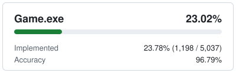
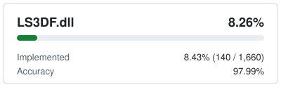
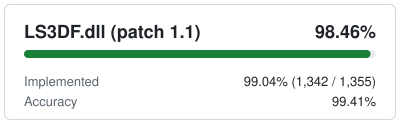
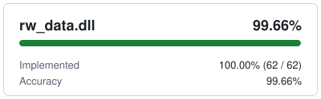
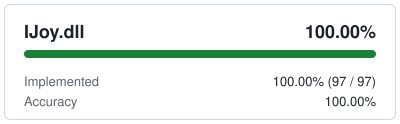
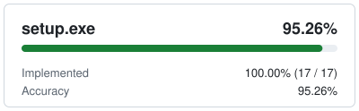

# Mafia-RE

A byte-exact decompilation of *Mafia: The City of Lost Heaven* (Illusion Softworks, 2002) for PC. When this source is
built with the compilers and linkers the game was made with, it produces files identical to the original binaries.

The main target is version 1.2, the last official patch and the version Steam ships. Version 1.0, patch 1.1 and Steam's
2010 rebuild of the setup are built from the same source, with their differences behind macros.

## Progress





Each card counts the binary's own functions and leaves out the C runtime. *Implemented* is how many of them have source.
*Accuracy* is [reccmp](https://github.com/isledecomp/reccmp)'s average score for those functions, and the bar adds up the
scores of all of them. `Game.exe`'s total is an estimate. [`docs/progress/`](docs/progress) lists the score of every
function.

| Binary | State |
| --- | --- |
| `rw_data.dll` | Done. The build is identical to the original. |
| `IJoy.dll` | Done. Linked on Windows 2000, the build is identical to the original. On current Windows only the order of the imports differs, because the linker sorts them with the system's `msvcrt.dll`. |
| `setup.exe` | Done. The builds are identical to the 1.2 setup, the 1.0 setup, Steam's 2010 rebuild and Steam's language versions. The Russian and Czech versions are identical when linked on Windows 2000. |
| `LS3DF.dll` | Every source file is written, for 1.2 and for patch 1.1. Nearly all functions compile to the original's instructions. Most of the rest differ in register allocation or in what the compiler inlines. |
| `Game.exe` | About half written, file by file ([docs/game-files.md](docs/game-files.md)). The rebuilt executable gets through the main menu, plays the intro cutscene and enters the game. No unprotected copy of the 1.2 executable survives, so the build is compared with a copy reconstructed from the retail files. |

## Versions

| Version | What is a target |
| --- | --- |
| 1.2 (2003) | Every binary. |
| Patch 1.1 (2003) | `LS3DF.dll`, with its differences behind `ENGINE_VERSION`. Its `Game.exe` survives only inside SafeDisc. |
| 1.0 (2002) | `setup.exe`, with its differences behind `SETUP_DATE`. Its `Game.exe` and `LS3DF.dll` aren't started. |
| Steam (2010) | `setup.exe`, with Steam's changes behind `SETUP_STEAM`, and the setups of Steam's language versions. |

`rw_data.dll` and `IJoy.dll` most likely didn't change between versions.

## Building

You need Windows, Git, Python 3 and CMake 3.29 or newer. You don't need the game to build, but you do need your own
copy of version 1.2 to compare a build with the original.

```bash
git -c core.autocrlf=false clone --recurse-submodules https://github.com/Marvisak/mafia-re.git
cd mafia-re
python -m venv .venv && .venv/Scripts/python -m pip install -r requirements.txt
cmake --preset vc6 && cmake --build --preset vc6        # Visual C++ 6.0, the byte-exact build, into build/vc6
```

Two other presets are optional:

- `vs2008` builds Steam's 2010 `setup.exe` with Visual C++ 2008 SP1 into `build/vs2008`.
- `msvc` builds everything with an installed Visual Studio into `build/msvc`. Run it from an x86 developer prompt. The
  result works but doesn't match the original.

The submodules in `3rdparty/` hold the original toolchains: Visual C++ 6.0 in three builds (from
[archaic-msvc](https://github.com/archaic-msvc)), [Visual C++ 2008 SP1](https://github.com/Marvisak/msvc900_sp1), and
the [DirectX 8.0](https://github.com/Marvisak/dx8sdk) and [8.1](https://github.com/Marvisak/dx81sdk) SDKs. In a clone
made without the submodules, run `git -c core.autocrlf=false submodule update --init`.

## Contributing

Contributions are welcome. [CONTRIBUTING.md](CONTRIBUTING.md) explains how to compare a build with the originals, how to
run the rebuilt `Game.exe`, and which conventions the code follows.
