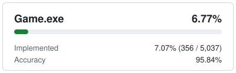
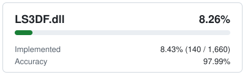
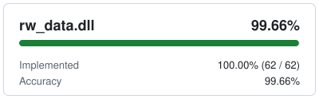
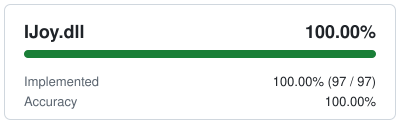
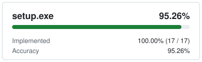
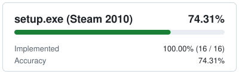

# Mafia-RE

Decompilation of *Mafia: The City of Lost Heaven* (Illusion Softworks, 2002), PC version 1.2: the last official patch, and
the version Steam ships.

The goal is a byte-exact decompilation: source code that, built with the compilers and linkers the original binaries were
built with, produces files identical to the originals.

## Progress





The cards count each binary's own functions, without the C runtime linked into it. *Implemented* is how many of them
have source, *accuracy* is [reccmp](https://github.com/isledecomp/reccmp)'s average score for those, and the bar is the
score summed over all of them. The function counts of binaries that haven't been started are estimates.
*setup.exe (Steam 2010)* is Steam's rebuild of the setup, built from the same source with Visual C++ 2008.

| Binary | Status |
| --- | --- |
| `rw_data.dll` | Fully decompiled. Most functions already compile to the original instructions; the rest, and the data layout, are still being matched. |
| `setup.exe` | The target is the 1.2 setup, built with Visual C++ 6.0 like the game. It builds with Visual C++ 6.0 and reccmp compares it, but the source was decompiled from Steam's 2010 rebuild (Visual Studio 2008) and is being redone against 1.2. The rebuild's differences stay in the source behind `SETUP_STEAM`, and it is compared too, built with its own toolchain (Visual C++ 2008 SP1). |
| `LS3DF.dll` (engine) | Started. It builds with Visual C++ 6.0 and reccmp compares it. The sound code and the engine's globals and C exports are written, and nearly all of their functions compile to the original instructions. With about 1,600 functions, this and `Game.exe` are the two big tasks ahead. |
| `Game.exe` | Not started. |
| `IJoy.dll` | Fully decompiled. All but one function compiles to the original instructions, and the rebuilt file matches the original apart from that function and the order of its import table. It is built with the original Visual C++ 6.0 release and the Processor Pack's code generator, as the original was. |

## Building

You need Windows, Git, Python 3 and CMake 3.29 or newer. Building doesn't need the game, but comparing a build with
the original binaries does: bring your own copy of version 1.2.

1. Clone the repository with its submodules, keeping git from changing their line endings:
   ```bash
   git -c core.autocrlf=false clone --recurse-submodules https://github.com/Marvisak/mafia-re.git
   ```
   In a clone made without them, run `git -c core.autocrlf=false submodule update --init`. The submodules in
   `3rdparty/` are the build tools the original binaries were made with:
   - `msvc600_sp5_vcpp`: Visual C++ 6.0 with Service Pack 5 and the Processor Pack, from
     [archaic-msvc](https://github.com/archaic-msvc/msvc600_sp5_vcpp).
   - `msvc600`: the original Visual C++ 6.0 release, which builds `IJoy.dll` (with the Processor Pack's code
     generator from `msvc600_sp5_vcpp`), also from
     [archaic-msvc](https://github.com/archaic-msvc/msvc600).
   - `msvc900_sp1`: Visual C++ 2008 SP1 with the Windows SDK 6.0A, which Steam's 2010 `setup.exe` was built with, from
     [Marvisak/msvc900_sp1](https://github.com/Marvisak/msvc900_sp1).
   - `dx8sdk`: the headers and libraries of the DirectX 8.0 SDK, which `setup.exe` was built with, from
     [anominy/dx8sdk](https://github.com/anominy/dx8sdk).
   - `dx81sdk`: the headers and libraries of the DirectX 8.1 SDK, which Steam's 2010 `setup.exe`, `IJoy.dll` and
     `LS3DF.dll` were built with, from [Marvisak/dx81sdk](https://github.com/Marvisak/dx81sdk).
2. Install the Python tools (they include Ninja):
   ```bash
   python -m venv .venv && .venv/Scripts/python -m pip install -r requirements.txt
   ```
3. Build with Visual C++ 6.0, the toolchain the game was built with. The output goes to `build/vc6`:
   ```bash
   cmake --preset vc6 && cmake --build --preset vc6
   ```
4. Optionally, build with an installed Visual Studio from an x86 developer prompt. The output goes to `build/msvc`, and
   it works but doesn't match the original:
   ```bash
   cmake --preset msvc && cmake --build --preset msvc
   ```
   Add `-DSETUP_STEAM=ON` to the first command to build Steam's 2010 `setup.exe` instead of the 1.2 one.
5. Optionally, build Steam's 2010 `setup.exe` with Visual C++ 2008 SP1, the toolchain it was built with. The output
   goes to `build/vs2008`:
   ```bash
   cmake --preset vs2008 && cmake --build --preset vs2008
   ```

[CONTRIBUTING.md](CONTRIBUTING.md) describes how to compare a build with the original binaries.

### setup.exe splash and icon

`setup/res/splash.bmp` and `setup/res/mafia.ico` are placeholders. The originals are the game's artwork and aren't
distributed with this repository. The setup builds and works with the placeholders, but shows a grey box instead of the
splash, and a byte-exact build needs the originals. Extract them from your own `setup.exe` (version 1.2, which is
`Patch\setup.exe` in the official 1.2 patch) over the placeholders:

- The splash, with [7-Zip](https://www.7-zip.org/):
  ```bash
  7z e -osetup/res path/to/setup.exe '.rsrc\1029\BITMAP\108.bmp' && mv setup/res/108.bmp setup/res/splash.bmp
  ```
- The icon: save icon group 1 (32×32 and 16×16 in one file) as `setup/res/mafia.ico` with a resource editor such as
  Resource Hacker. 7-Zip exports the two sizes as separate files, which won't do.

Don't commit the extracted files. Git shows them as modified; this hides them:

```bash
git update-index --skip-worktree setup/res/splash.bmp setup/res/mafia.ico
```

## Contributing

Any contributions are welcome, all information for contributors is in [CONTRIBUTING.md](CONTRIBUTING.md).
